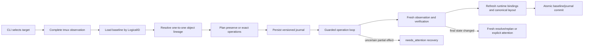

# Reconcile State and Identity Design

## Status

Approved for implementation. This is the source of truth for preset creation, baseline identity, layout binding, reconciliation, journaling, and verification. It replaces the overlapping contracts currently described in `docs/specs/reconcile-v2.md`; database tooling remains governed by `docs/specs/database-access-v1.md`.

## Intent

Gotomux stores reusable session instances and frozen baselines, then reconciles a live tmux session toward the selected baseline. The session name is a locator. Correctness depends on preserving one identity lineage across the stored preset, frozen baseline, and recreated tmux objects while tmux runtime IDs change.

The design must support:

- Recreating a saved preset after its old tmux session is gone without minting a different logical session identity each time.
- Rebuilding baseline windows and panes by durable slot identity, while targeting current live objects by tmux runtime ID.
- Applying saved pane placement after tmux has issued new pane IDs.
- Resuming operations after interruption without repeating completed mutations.
- Keeping legacy baselines with no identity untouched. A user can load a preset; reconciliation of that instance requires an explicit freeze that creates a valid baseline.
- Keeping the existing CLI surface and default preserve behavior.

## Observed failures that define the requirements

The `kho-cong` history exposed three separate contract breaks:

1. Preset rows did not persist session/window/pane identity, while the baseline did. Recreating the preset assigned new IDs and collided with the old baseline identity.
2. Tmux JSON layout leaves held old pane runtime IDs such as `%19`, while pane records had current IDs such as `%57`. A reconcile operation could not connect a layout leaf to its current live pane.
3. Verification treated the active window captured at plan time as required final state, even when the plan had no operation that selected a window. A focus change became a false reconciliation failure after the topology operation had completed.

The implementation also revealed a fourth lifecycle gap: a final verification failure can leave a journal at `completed_step == len(operations)`. Resuming such a journal executes no operations and repeats the same final verification. Journal recovery needs an explicit terminal-failure rule.

## Approaches considered

### A. Keep the existing boundaries and standardize their contracts — recommended

Retain `internal/template` orchestration, pure `internal/reconcile/core`, effectful `internal/reconcile/runner`, `internal/tmux` adapters, `internal/tmuxlayout`, and `internal/store`. Define one canonical identity flow and the exact ownership of each state field. Add plan versioning and specific recovery transitions where the current boundaries need them.

This uses the separation already present in the repository and limits change to the inconsistent handoffs.

### B. Replace reconciliation and persistence with a new orchestration service

Introduce new domain repositories, operation types, and a replacement workflow. This could reset accumulated assumptions but would duplicate working resolver, tmux observation, and transaction code, and would enlarge the review and migration surface.

### C. Patch each reported error locally

Change only the caller or error branch for the latest symptom. This is fast for one reproduction but leaves runtime IDs in stored layouts, unversioned journal plans, and undefined terminal recovery behavior.

**Recommendation:** Approach A. The existing module boundaries are useful; the root problem is that their data contracts do not agree.

## Canonical domain model

### Identity and location are separate

| Value | Meaning | Lifetime | Allowed use |
|---|---|---|---|
| `LogicalID` | Identity of one saved session instance | Persistent across tmux recreation and supported rename | Match a preset and baseline to one logical session |
| `SlotID` | Identity of one required window or pane in that instance | Persistent across tmux recreation | Map a desired baseline slot to a live object |
| `RuntimeID` (`$`, `@`, `%`) | tmux session, window, or pane handle | Only within one server generation and object lifetime | Select an already observed live object for a guarded mutation |
| `ServerKey` | Generation of one tmux server | Until that server exits/restarts | Scope all runtime IDs |
| Name/index/path/command/role | Locator, destination, or evidence | Mutable | Candidate discovery and comparison; never sole identity |
| Active window/client | Interactive focus | Changes independently of the frozen session | Optional execution context; never baseline identity |

Each baseline has one session `LogicalID` and a unique `SlotID` for every required window and pane. Session/window/pane runtime IDs may be cached beside the baseline but are disposable observations, not the identity source.

`ServerKey` is the composite of tmux socket path, tmux server PID, and the socket file's device, inode, and ctime, as currently derived by `tmuxServerKey`. `Ctl.Observe` reads it before and after collecting the snapshot. A cached runtime ID is reusable only when the current complete snapshot has the same `ServerKey` and still contains that runtime object with the expected membership/identity. A PID or socket path match alone is insufficient. If socket metadata changes while tmux is still running, the design chooses a conservative false invalidation and requires a fresh observation; it never reuses a runtime ID across a questionable generation boundary.

### Separate the three session representations

The domain now uses `model.Recipe`, `model.Baseline`, and `model.ObservedSession`. `model.Session` remains a compatibility and persistence DTO. Conversion boundaries strip runtime values from recipes and project baseline bindings by stable slot.

- **Recipe:** saved project path, command intent, ordered windows/panes, logical ID, slot IDs, and canonical layout blueprint. It has no tmux runtime IDs.
- **Baseline:** desired recipe plus a separate optional last-known binding set paired with `ServerKey`.
- **Observed session/snapshot:** one current incarnation with runtime IDs, slot tags, server generation, and memberships.

Conversions are explicit at store/load, freeze, observation, and commit boundaries. Reconcile planning consumes a `Baseline`; tmux observations use `ObservedSession`. The store exposes typed baseline and recipe repositories while retaining the existing JSON body through Goose/sqlc.

### Preset and baseline relationship

- A saved preset is an instance recipe for a logical session and persists its `LogicalID` and window/pane `SlotID`s.
- A baseline is the last frozen, identity-complete desired state for that same `LogicalID`.
- A shape is reusable topology/product intent. Creating a new session from a shape creates a new `LogicalID` and new slot IDs.
- Loading an identified preset reuses its identity. It does not clear IDs merely because tmux runtime IDs will be new.
- A v1–v8 preset whose identity columns are empty may inherit IDs only on an exact ordered recipe match. An edited recipe is a new revision under the same logical instance: unchanged units retain slots, changed units receive new slots, and their old runtime bindings are cleared.
- If an old baseline has no `LogicalID` or slot IDs, it is unsupported for reconcile and remains untouched. Loading a preset may create fresh IDs and persist them on the preset; it does not reinterpret or rewrite the unidentified baseline. `gotomux -f` is the explicit action that replaces it with a valid baseline.
- A nonempty preset ID that conflicts with a nonempty baseline ID is a hard conflict. Loading stops before `tmux new-session`.

## Canonical layout representation

Tmux 3.8 JSON layouts embed pane identifiers (`I`) and pane indices (`i`). Those embedded IDs belong to a particular runtime and must not be treated as durable. Preset and baseline layout values use a typed canonical blueprint whose leaves refer to `SlotID`; the live adapter has a separate tmux-layout value whose leaves refer to current pane runtime IDs.

- Persist preset/baseline layout leaves by `Pane.SlotID`; preserve the split tree and pane-to-leaf order. Pane `i` is a position binding within that saved tree, not object identity.
- Tmux pane/session creation returns exact runtime IDs. Tag the new objects with the preset's logical/slot IDs, then bind each layout leaf through its slot to the observed runtime pane.
- Apply the runtime layout only after the tree has been observed and the slot-to-runtime mapping is complete. Do not send stored JSON containing IDs from an older tmux session directly to `select-layout`.
- On observation, map each live layout leaf to a slot from the observed pane bindings. On baseline refresh, persist slot references again and update pane positions from verified bindings.
- A missing/duplicate pane index, missing slot, unmatched leaf, or pane-count mismatch is a conflict. Do not guess by pane name or reuse a stale runtime ID.
- Legacy checksum layouts remain supported as topology strings; they contain no embedded runtime IDs.

This makes pane placement a slot-to-leaf relationship, while runtime IDs are only a temporary execution binding.

## Preset creation and loading

Preset loading is a separate identity lifecycle from reconcile:

1. Read the stored preset and its persisted logical/slot IDs. If they are present, use them as the desired identity tree. A transient shape/bake gets fresh IDs.
2. For an old preset with empty ID columns, reuse baseline IDs only after exact comparison of the entire persisted instance shape. An unidentified legacy baseline contributes no identity and remains untouched; the newly instantiated preset receives fresh IDs, and a later explicit freeze creates a valid baseline.
3. Create the session/window/pane objects and retain each runtime ID returned by tmux. Assign logical/slot IDs only to those exact returned objects.
4. Resolve the canonical layout blueprint to those new runtime IDs and apply it. Reobserve and validate session membership, slot tags, pane count, and leaf placement.
5. Persist preset IDs and baseline state after validation. A partial failure must either clean up the exact newly created object set under verified runtime IDs or leave a recoverable creation record; it must not return success with an unattached, untracked session.

If the preset already has a nonempty logical ID that conflicts with a nonempty baseline ID, stop before creating tmux objects. A same-name baseline with no identity is not an identity conflict and must not block preset instantiation.

## Connect-or-create routing

The picker has three different intents: attach to a live session, instantiate a stored preset, and create a project/shape instance. These intents must not collapse into `Has(name) -> Connect(name)`:

- **Attach live item:** the picker selection carries the observed server generation and session runtime ID. Connect to that exact live session. Its name is display/lookup text.
- **Connect preset with an existing live session:** observe it and compare its `LogicalID` with the selected preset's persisted ID. If tags are missing, use the same complete-snapshot resolver and evidence rules as the rest of the system. A conflicting or ambiguous association stops before attaching.
- **Instantiate a preset with no live session:** use the preset-identity lifecycle above; create, tag, verify, persist, then attach.
- **Create from project/shape:** use canonical project root as corroborating project identity and allocate a new logical session ID. If a sanitized name already resolves to another logical project/session, report the conflict instead of silently connecting by name.

All callers (standalone and daemon picker paths) use this same decision. The daemon's `connect` request remains telemetry only and is never treated as proof that tmux created or attached a session.

The creation flow must expose exact runtime handles from tmux object creation. If a later tagging or persistence step fails, it may clean up only the session created by that operation after rechecking server generation and runtime ID. If ownership cannot be proved, leave it for explicit recovery and report the partial state; never kill a session by name as rollback.

## One reconcile flow

1. `main.go` selects a target name and policy. Names locate a candidate; they never select a baseline identity by themselves.
2. `Ctl.Observe` returns one complete, server-scoped snapshot. It includes target membership, session/window/pane runtime IDs, logical/slot IDs, layout and pane evidence. A partial observation is an error.
3. `template.ReconcileSession` loads the baseline by live session `LogicalID`. If the live tag is missing, same-server runtime lineage may identify the session; name-only fallback is forbidden for destructive or persistent identity decisions.
4. `core.Resolve` validates identifiers and returns one-to-one matches, unmatched slots, extras, evidence, ambiguity, and conflicts. It performs no I/O or writes.
5. `core.Plan` produces immutable operations. Preserve restores required structure and leaves extras/processes alive. Exact is explicitly destructive. Indices are destinations; runtime IDs select objects.
6. The journal stores a versioned plan before mutations. The runner observes/precondition-checks, applies one operation, observes/postcondition-checks, then advances the cursor.
7. A fresh observation is resolved against the same identity lineage. Verification checks required objects, memberships, roles, pane slots, topology, and layout leaf placement. It does not check UI focus.
8. `RefreshBindings` updates runtime IDs and canonical layout leaf bindings from the verified mapping. `CommitReconcile` commits the refreshed baseline and journal completion atomically.

## Active focus contract

Active-window/client focus is not stored in the baseline, so it is not a reconcile postcondition and must not be included in the structural snapshot fingerprint. Focus changes before or during reconciliation do not stale a topology plan. The runner must avoid changing focus as a side effect where tmux supports a non-selecting operation. Preserve does not add a focus-selection operation to its structural plan. Exact rebuild may select the first baseline slot as a deterministic completion default, but that choice is an operation-level UI behavior, not a frozen session property and not a terminal topology postcondition.

## Journal and recovery contract

PlanResult is persisted JSON and its plan schema version is 2. It stores a typed baseline separating desired recipe from server-scoped runtime bindings. Unsupported older plans that may have mutated tmux are quarantined; an unstarted plan is aborted and rebuilt.

- `planned`, cursor 0: no operation has completed. If the start preconditions no longer match, abort and build a new plan from a fresh snapshot.
- `running`, cursor `k`: operations `[0,k)` were observed complete. Re-observe and resume only the next operation under its identity and fingerprint checks.
- `needs_attention`, cursor `< operation count`: the next operation's outcome or precondition needs recovery. Keep the plan pinned; never blindly create a duplicate.
- `needs_attention`, cursor `== operation count`: all recorded operations completed but terminal verification failed. Do not rerun the same completed list indefinitely. For preserve, re-resolve from a fresh snapshot and supersede the old plan only after confirming no operation markers or uncertain effects remain. For exact rebuild, resume the existing exact phase only when the original server/session generation matches and every staged object is uniquely owned by the operation marker. Each desired window/pane may carry either its deterministic temporary slot ID (promotion pending) or its exact final baseline slot ID (promotion already completed); no other slot/marker pairing is recoverable. Originals that remain must match their recorded fingerprints; an absent original counts as already removed only when every replacement is uniquely operation-owned. Missing, duplicate, foreign, or contradictory markers stop with `needs_attention` and leave observed objects untouched. Cleanup markers only after a full fresh verification succeeds.
- Unsupported journal plan version: do not reinterpret its JSON. If cursor is 0, abort and replan. If any mutation may have occurred, stop with `needs_attention` and an explicit diagnostic path.
- `complete` is written only in the same transaction as the baseline binding refresh. `aborted` means the plan will not resume.

Every error includes phase, operation ID, cursor, and whether the journal has pending mutations. Logs distinguish telemetry events from actual preset creation/attachment.

## Policies and CLI

- `--reconcile` remains preserve by default; it does not kill extra panes/windows or change user commands.
- `--hard` remains exact and requires confirmation; `--force` skips confirmation only.
- No flags for mapping windows, selecting baseline IDs, repairing journals, or choosing identity fallbacks are added.
- An unidentified baseline blocks reconcile and points to `gotomux -f`; a stale baseline row does not block loading a saved preset into a new identified instance.

## Component ownership

- `internal/model`: versioned identity, snapshot, resolution, operation and journal value types. Keep client focus separate from desired-state values.
- `internal/store`: Goose schema lifecycle, sqlc persistence, preset/baseline ID association and atomic reconcile commit.
- `internal/tmux`: complete observation, namespaced tmux identity options, and guarded operations addressed by server-scoped runtime IDs.
- `internal/tmuxlayout`: pure parsing, topology comparison, stable-slot layout normalization, and runtime remapping.
- `internal/reconcile/core`: pure resolver/planner/verifier; no store or tmux imports.
- `internal/reconcile/runner`: journaled effects, preconditions, postconditions, and recovery; no matching policy.
- `internal/template`: orchestration only: observe → resolve → plan → execute/recover → verify → refresh → commit.
- `main.go`: CLI target/policy selection and reporting.

Standalone and daemon paths share the same store and tmux semantics. Reconcile stays off daemon startup/polling and picker ranking paths.

## Invariants

1. No mutation from an incomplete snapshot, unknown server generation, contradictory ID, or materially ambiguous identity.
2. Names, paths, commands, pane counts, semantic roles, and indices are evidence/attributes; no single mutable signal establishes ownership.
3. A stable slot is assigned only after a verified association. Extra live objects remain untagged.
4. Persisted JSON layouts reference stable pane slots, never runtime pane IDs.
5. Every operation revalidates the target server generation, runtime ID, identity, membership, and relevant fingerprint immediately before mutation.
6. Preserve does not kill a user process. Exact can replace processes only after identity validation and confirmation.
7. A successful immediate repeat is a no-op and does not change object identities or layout leaf placement.
8. Runtime bindings and journal completion are committed only after fresh verification.
9. An old plan is either explicitly upgraded or refused according to its plan version and cursor; it is never guessed into the new format.
10. Legacy unidentified baseline contents are never assigned synthesized identities or silently rewritten during schema adoption.

## Required acceptance scenarios

- Load an identified preset after its tmux session was killed: recreate the same logical/slot IDs with new runtime IDs.
- Load a v1–v8 preset whose content exactly matches an identified baseline: recover those IDs and persist them on the preset.
- Load a preset with no identity and an unidentified legacy baseline: create a new identified session, leave the legacy baseline untouched, and require an explicit freeze before reconcile.
- Same preset name with nonempty conflicting logical IDs: stop before `new-session`.
- Tmux 3.8 JSON layout contains stale runtime pane IDs but leaf indexes and slot mapping are valid: remap by the saved layout leaf → baseline slot → live pane chain; never fail solely because old pane IDs changed.
- Pane index order and layout leaf order differ: retain the frozen slot-to-leaf mapping and make the second reconcile a no-op.
- Active focus changes during preserve: reconcile still verifies/commits the structural result and does not select a window as an unrequested consequence.
- Apply-layout completed but final verification failed: resume from cursor without replaying the operation; classify the terminal failure according to policy rather than looping forever on a completed plan.
- Interrupt after each mutation boundary: recovery observes tmux and never duplicates a completed create/split.
- Existing journal with a prior plan schema: abort only when certainly unstarted; otherwise quarantine before replay.

## Rollout boundary

This contract is implemented on dev. Full unit and isolated tmux integration tests, build, vet, deterministic sqlc generation, and Goose migration checks are the verification evidence. Existing CLI surface remains unchanged.
